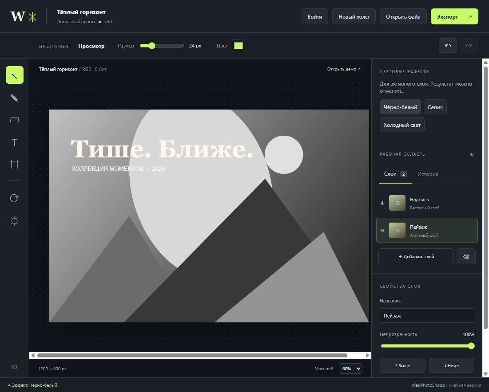

# WebPhotoShoop

Учебный веб-фоторедактор. Актуальная версия **0.3.0** включает работу заданий 1–7: растровый редактор, цветовые эффекты и серверные учётные записи. Предыдущие версии сохранены для сравнения. Дальнейшее развитие — расширение инструментов обработки изображений.



## Быстрый запуск

Нужен Node.js 22 или новее и npm. В терминале папки проекта:

```powershell
npm ci
npm run build
npm start
```

На этом компьютере открыть **http://localhost:3001**. Чтобы заказчик подключился, запустите сервер на компьютере, который будет его раздавать, и передайте ему адрес из строки `В локальной сети` в терминале, например `http://192.168.1.10:3001`. Устройства должны быть подключены к одной локальной сети; при первом запуске Windows может попросить разрешить Node.js доступ через брандмауэр для частных сетей.

Если порт занят:

```powershell
$env:PORT = '3002'
npm start
```

Для разработки — `npm run dev`; Vite выведет локальный и сетевые адреса. Сервер API запускается отдельно командой `npm start`, если он нужен при разработке. Собранное приложение не зависит от API для обработки фотографий.

Это открывает доступ устройствам в той же локальной сети. Для доступа заказчика из другой сети приложение нужно разместить на хостинге или настроить VPN/туннель; одного запуска сервера недостаточно. В версии 0.3 добавлены регистрация и вход. Для настоящих учётных записей нужен HTTPS; HTTP в локальной сети раскрывает передаваемые данные.

## Что реализовано

- Открытие PNG, JPEG и WebP с устройства или перетаскиванием; проверка типа, размера файла и количества пикселей.
- Новый прозрачный холст, встроенный демонстрационный пейзаж.
- Растровые слои: создание, удаление, выбор, имя, видимость, порядок и непрозрачность.
- Кисть, ластик и добавление текста по щелчку. Размер и цвет настраиваются.
- Обрезка по координатам и поворот всего документа на 90 градусов.
- Яркость, контраст и насыщенность активного слоя.
- Отмена и повтор изменений, ограниченная история, адаптивный бюджет снимков.
- Экспорт видимых слоёв в PNG, JPEG и WebP. Для JPEG прозрачность заменяется белым фоном.
- Русские сообщения об ошибках, индикатор ожидания, предупреждение при закрытии изменённой работы.
- Адаптивная компоновка и горячие клавиши V, B, E, T, C, Ctrl+Z, Ctrl+Shift+Z.
- Цветовые эффекты активного слоя: чёрно-белый, сепия и холодный свет с отменой и повтором.
- Регистрация, вход, сохранение сеанса после перезагрузки и выход; защищённый серверный профиль.
- Сервер Node.js: раздача сборки, `/api/health`, `/api/capabilities` и `/api/auth/*`.

Фотографии обрабатываются через Canvas в браузере и не отправляются на сервер. Сервер хранит учётные записи и проверяет сессии, но пока не хранит проекты и не обрабатывает изображения. React — библиотека клиентского интерфейса, TypeScript — язык с типизацией; серверная часть написана на JavaScript для Node.js.

## Как попробовать

1. Нажать «Попробовать на демо».
2. Добавить слой, выбрать кисть и нарисовать на холсте.
3. Выбрать текст, ввести надпись в верхней панели и щёлкнуть на холсте.
4. Изменить видимость и непрозрачность слоя, проверить отмену.
5. Нажать «Экспорт», выбрать формат и скачать результат.

«Просмотр» служит режимом без рисования. Перемещение отдельных объектов, редактирование уже нанесённого текста, маски, PSD, векторные инструменты, сохранение многослойного проекта и автосохранение относятся к будущим этапам. После перезагрузки остаётся только ранее скачанное изображение. Экспорт создаёт плоское изображение и не сохраняет слои для дальнейшего редактирования.

## Материалы заданий

| Задание | Подготовленные материалы |
| --- | --- |
| 1 | [Идея и границы проекта](docs/01-концепция.md), начальный прототип |
| 2 | [Девять прототипов](docs/prototypes/index.html), [описание состояний](docs/02-прототипы.md), [отчёт ARIS](docs/reports/ARIS.pdf) |
| 3 | Диаграммы отложены по указанию пользователя; отчёт не требуется |
| 4 | Уточнённые прототипы обрезки и коррекции, работающая версия; диаграммы отложены |
| 5 | [Отчёт КИС](docs/reports/КИС.pdf), [техдолг](docs/05-технический-долг.md), [стратегия тестирования](docs/05-тестирование.md), [совместимость](docs/05-совместимость.md), [история изменений](CHANGELOG.md) |

Отчёты посвящены своим темам и не привязаны к фоторедактору. Они включают иллюстрации учебных рабочих форм и таблицы со ссылками в предшествующем тексте. Редактируемые исходники отчётов — Markdown рядом с PDF. Диаграммы UML и ARIS пока не создавались; в отчёте ARIS нотация рассмотрена текстом и таблицей.

## Архитектура и ограничения

`EditorDocument` управляет холстом и слоями; `History<T>` — отменой и повтором. `filters.ts` содержит преобразование каналов. React связывает модель и интерфейс. Node.js использует стандартную библиотеку без серверного фреймворка. Такой состав позволяет постепенно выделять самостоятельные сервисы и инструменты, не начиная с полноценной облачной платформы.

До 8 миллионов пикселей на холст, до 12 слоёв и до 16 миллионов пикселей суммарно по слоям. История хранит до 8 состояний и сокращается с ростом документа. Лимиты уменьшают риск нехватки памяти, но не гарантируют стабильную работу на любом устройстве. Декодирование входного файла зависит от браузера; большие изображения стоит предварительно уменьшать.

В [реестре техдолга](docs/05-технический-долг.md) описаны оставшиеся риски, включая синхронную коррекцию больших изображений и отсутствие автосохранения. Результаты проверок и непроверенные платформы указаны в [матрице совместимости](docs/05-совместимость.md). Скриншоты приложения хранятся отдельно от проектных макетов.

## Структура

```text
src/core/          Модель документа, история, коррекция
src/App.tsx        Интерфейс редактора
src/style.css      Оформление и адаптивность
server/            HTTP-сервер и API
tests/             Проверки логики и HTTP
docs/prototypes/   Проектные макеты и галерея
docs/reports/      Отчёты PDF, исходники и иллюстрации
docs/verification/ Снимки реального приложения и результат экспорта
scripts/           Воспроизводимая подготовка иллюстраций и PDF
```

Пакеты приложения устанавливаются по `package-lock.json`. Скрипты подготовки отчётов запускаются отдельно: нужны Python, Pillow, ReportLab, pypdf и pypdfium2 и доступные шрифты Arial. Для обычного запуска редактора Python не нужен.

## Задания 6 и 7

Версия 0.2 добавляет цветовые эффекты, версия 0.3 — регистрацию и авторизацию. Пошаговое сравнение: [демонстрация версий](docs/07-демонстрация.md). Исходная версия сохранена тегом v0.1.0, версия задания 6 — v0.2.0, актуальная — v0.3.0.

[Анализ защиты задания 6](docs/06-защита.md) ведётся отдельно от теоретического отчёта. [Устройство и ограничения авторизации](docs/07-авторизация.md) содержит API, параметры запуска и правила хранения данных. Теоретические отчёты: [MPS и MRP I](docs/reports/Задание%206%20MPS%20и%20MRP%20I.md) и [MRP II ERP ERP II](docs/reports/Задание%207%20MRP%20II%20ERP%20ERP%20II.md). Оформленные DOCX с титульными данными исполнителя сохраняются локально в соседней папке «Отчёты».

Для регистрации нажмите «Войти» → «Создать учётную запись», укажите email и парольную фразу от 15 до 128 символов. При создании выполняется автоматический вход. Email служит именем учётной записи и пока не подтверждается письмом. Можно редактировать фотографии без входа. Наличие учётной записи пока не добавляет облачное хранение работ.

Пароли хешируются scrypt с индивидуальной солью; браузер получает HttpOnly cookie. Файл data/users.json создаётся автоматически и исключён из Git. Не переносите его в dist или публичный архив. Сервер рассчитан на один процесс; сессии хранятся в памяти и прекращаются после перезапуска. Ограничения реализации описаны в документе авторизации.

Для HTTPS за обратным прокси задайте APP_ORIGIN=https://editor.example до npm start: Origin должен точно совпадать с адресом сайта, cookie получает Secure. Для обычного localhost переменная не нужна. DATA_DIR задаёт закрытую папку учётных записей; по умолчанию используется data в рабочем каталоге. Пример — [.env.example](.env.example); файл .env автоматически не загружается.
