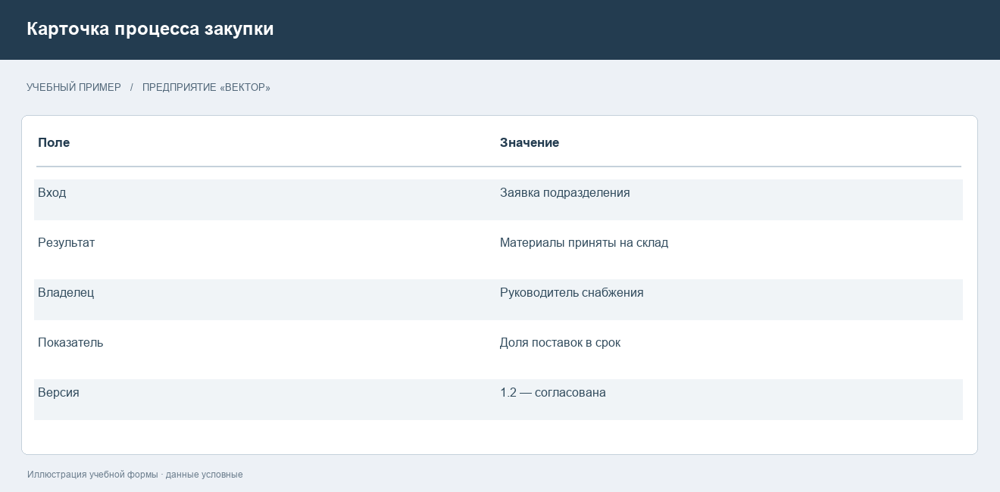
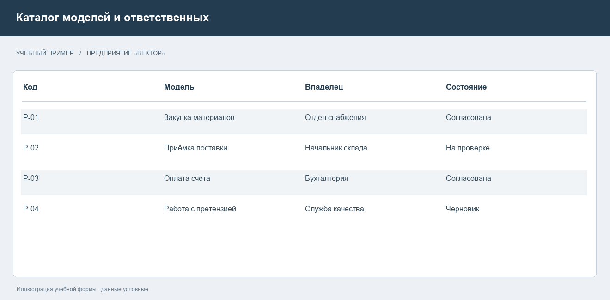

# Методология ARIS и описание деятельности предприятия

## Назначение и область применения

ARIS — Architecture of Integrated Information Systems — представляет деятельность организации через взаимосвязанные модели. В центре внимания находятся процессы, исполнители, информация, функции и результаты работы. Такой подход нужен, когда одного регламента недостаточно: обязанности распределены между подразделениями, сведения хранятся в разных системах, а ошибки обнаруживаются только в конце цепочки. Модель позволяет заранее установить, кто выполняет действие, какие сведения ему нужны и какое условие разрешает продолжить работу [1, 2].

Практический смысл моделирования состоит в получении согласованного описания деятельности. У подразделений часто различаются представления об одном процессе. Снабжение считает закупку завершённой после отправки заказа, склад — после приёмки товара, бухгалтерия — после проведения документов. Пока граница процесса не определена, показатели подразделений могут выглядеть благополучно, хотя предприятие получает материалы с опозданием.

В этом отчёте рассматриваются основные представления ARIS, назначение моделей и правила работы с нотацией EPC. Для пояснений используется самостоятельный учебный пример предприятия «Вектор», которое закупает материалы для производства. Название предприятия и все числовые данные условны. Пример нужен для разбора методики, а не для описания конкретной организации.

Результатом моделирования следует считать проверенную и согласованную модель, которую можно использовать при разработке регламента, распределении ответственности или изменении информационной системы. Наличие красивого изображения само по себе не подтверждает правильность процесса. Для модели необходимы владелец, область действия, версия, дата согласования и связь с исходными материалами.

Дальнейшее изложение разделяет два вопроса: что именно нужно описать и каким способом проверить описание. Это помогает не смешивать устройство организации, порядок выполнения работ и техническую реализацию системы.

## Представления деятельности и уровни описания

Разделение деятельности на представления позволяет рассматривать сложную систему по частям. Организационное представление отвечает на вопрос об исполнителях и подчинённости. Функциональное раскрывает состав выполняемых работ. Представление данных описывает используемую информацию. Представление продуктов и услуг фиксирует результаты. Процессное представление связывает эти сведения в контекст выполнения деятельности [1].

Например, запись «Проверить заявку» относится к функциям. «Менеджер по снабжению» обозначает роль. «Заявка на закупку» является информационным объектом. «Материалы приняты на склад» описывает состояние, имеющее значение для процесса. Эти объекты нельзя подменять друг другом: сотрудник не является действием, а документ не определяет последовательность выполнения работ.

Уровень подробности выбирают по цели. Руководителю направления требуется обзор процессов и их результатов. Владельцу процесса нужны условия переходов, ответственность и исключения. Разработчику автоматизации дополнительно требуются поля документов, проверки значений и интерфейсы обмена. Попытка разместить всё на одном листе затрудняет чтение и скрывает главную мысль.

Сопоставление представлений приведено в таблице 1. Она показывает, какие вопросы следует задавать при сборе материалов.

Таблица 1 — Представления деятельности в учебном примере

| Представление | Основной вопрос | Пример сведений |
| --- | --- | --- |
| Организационное | Кто отвечает | Снабжение, склад, бухгалтерия |
| Функциональное | Что выполняется | Проверка потребности, выбор поставщика |
| Данных | Какая информация нужна | Заявка, договор, накладная |
| Продуктов и услуг | Какой результат получен | Обеспеченная потребность производства |
| Процессное | В каком порядке и при каких условиях | От заявки до принятой поставки |

При переходе к детальному описанию необходимо сохранять связь с исходной задачей. Если уточнение не влияет на решения участников, его можно вынести в атрибуты объекта или отдельный регламент. Это уменьшает перегрузку модели.

## Сбор сведений и границы процесса

Моделирование начинается со сбора фактов. Источниками служат действующие регламенты, формы документов, интервью, записи информационных систем и наблюдение за выполнением работы. Каждый источник имеет ограничения. Регламент может описывать желаемый порядок, интервью — личную практику исполнителя, журнал системы — только автоматизированные операции. Поэтому существенные переходы полезно подтверждать несколькими видами материалов.

Для закупки на предприятии «Вектор» начальным условием принята зарегистрированная потребность подразделения, конечным — принятые материалы и закрытые документы поставки. Внутри границы находятся проверка заявки, согласование потребности, выбор поставщика, оформление заказа, контроль поставки и передача документов. Планирование производства и ведение бухгалтерской отчётности рассматриваются как соседние процессы.

Владелец процесса отвечает за общий результат, даже если часть действий выполняют другие подразделения. Исполнитель конкретной функции отвечает за свою операцию. Эти роли могут совпадать, однако их различение необходимо для разбора задержек. Иначе каждый участник будет объяснять проблему действиями соседнего подразделения.

На рисунке 1 показана учебная карточка процесса. В ней собраны границы, результат и ответственность, которые следует согласовать до подробного моделирования.

После согласования границ составляют список типовых исключений: неполная заявка, превышение бюджета, отсутствие поставщика, недопоставка, расхождение документов. Исключения влияют на порядок работы и должны учитываться вместе с основным сценарием. Редкие технические подробности при этом не обязаны попадать в обзорную модель.

## Нотация EPC и назначение элементов

EPC описывает управление процессом через события, функции и логические операторы. Событие фиксирует значимое состояние или факт. Функция обозначает выполняемую работу, которая занимает время. Оператор определяет правила разветвления и объединения потока. Официальное описание ARIS выделяет эти элементы как основу управления процессом [2, 3].

Для именования события используют результат: «Заявка зарегистрирована», «Поставка получена». Для функции применяют действие с объектом: «Проверить заявку», «Принять материалы». Название «Проверка» без объекта не показывает, что именно проверяется. Название «Заявка» не позволяет понять, идёт ли речь о документе, его создании или результате согласования.

Основные обозначения перечислены в таблице 2. Цветовая схема в таблице описывает принятую для учебных моделей традиционную палитру; конкретные настройки оформления могут зависеть от инструмента. Значение элемента определяется его типом и формой, поэтому один цвет не заменяет нотацию.

Таблица 2 — Основные элементы EPC и связанные объекты

| Элемент | Форма и принятое оформление | Смысл |
| --- | --- | --- |
| Событие | Шестиугольник, розовый или сиреневый | Наступившее состояние |
| Функция | Скруглённый прямоугольник, зелёный | Выполняемое действие |
| AND | Круг с символом ∧ | Все ветви обязательны |
| OR | Круг с символом ∨ | Одна или несколько ветвей |
| XOR | Круг с символом XOR | Ровно одна альтернативная ветвь |
| Организационная единица | Овал, жёлтый | Подразделение, связанное с функцией |
| Информационный объект | Обозначение соответствующего типа данных | Вход или результат функции |

Сведения об исполнителях и документах присоединяют к функциям как контекст. Они не должны становиться случайными промежуточными узлами потока управления. Выбор дополнительного объекта зависит от используемого метода и фильтра типов моделей [3].

## Логика ветвления и проверка корректности

Оператор XOR применяют, когда возможен только один результат выбора. После проверки лимита заявка может быть согласована либо отклонена. Если оба исхода должны случиться одновременно, такое описание противоречит смыслу решения. Основание выбора относится к проверке, то есть к функции, а события фиксируют полученные результаты.

AND используют для параллельных обязательных действий. После подтверждения заказа можно одновременно подготовить место на складе и уведомить производственное подразделение. Если продолжение процесса требует обоих результатов, объединение должно ждать завершения обеих ветвей. Необязательная задача, ошибочно включённая в обязательное объединение, способна сделать описанный процесс незавершаемым.

OR означает выполнение одной или нескольких ветвей в зависимости от условий. Например, при поступлении материалов могут потребоваться проверка сертификата и контроль упаковки, причём набор проверок зависит от категории поставки. Такой оператор сложнее для анализа, поэтому его применяют там, где действительно необходим выбор нескольких ветвей. Если достаточно альтернативы из двух исходов, предпочтительнее явно описать исключающий выбор [2].

В учебной закупке нужно отдельно решить, что происходит после отклонения заявки. Возврат на уточнение предполагает новую проверку, а окончательный отказ завершает заявку. Нельзя объединять эти ситуации одним безымянным переходом. Аналогично расхождение при приёмке требует определённого выхода: повторной поставки, частичного принятия или оформления претензии.

Проверка модели включает достижимость конечных результатов, отсутствие оборванных переходов, осмысленное чередование событий и функций, согласованность разветвлений и объединений. Начальные и конечные события должны отражать согласованные границы. Параллельные пути анализируют отдельно: важно установить, какие результаты действительно нужны для продолжения и кто подтверждает их получение.

Проверять полезно не только основной успешный путь. Для каждого решения следует пройти хотя бы один отрицательный сценарий и убедиться, что у процесса остаётся определённое завершение или корректный возврат на доработку.

## Иерархия функций и единый каталог

Функциональное описание раскрывает состав деятельности. Функция «Обеспечить предприятие материалами» может включать определение потребности, закупку, контроль поставки и оценку поставщиков. Дальнейшая декомпозиция уточняет содержание каждой работы. Иерархия отвечает на вопрос «из каких работ состоит деятельность», а порядок исполнения требует отдельного процессного описания.

Для стабильного каталога необходимы правила именования. Функции называют единообразно, например глаголом в неопределённом наклонении и названием объекта. Роли задают по ответственности, а не только по фамилии сотрудника. Тогда кадровая перестановка не потребует переименования множества объектов. Для документов фиксируют вид и назначение, а не случайное имя файла.

Общий объект и его графическое появление в конкретной модели следует различать. Одна роль может участвовать в нескольких процессах. Если в каждом случае создавать независимую копию, изменения ответственности станут расходиться. Управляемое повторное использование объектов помогает поддерживать согласованность описаний.

На рисунке 2 приведён пример каталога моделей. Его задача — показать учёт владельцев и состояний согласования без подмены содержания процесса списком файлов.

В каталоге для каждой модели полезно хранить код, название, назначение, владельца, версию и статус. Черновик должен отличаться от утверждённой версии. Если регламент ссылается на модель, нужно указывать конкретную редакцию либо применять установленное правило получения актуальной версии. Это предотвращает ситуацию, когда разные подразделения работают по различающимся описаниям.

## Анализ процесса и подготовка изменений

Модель существующей деятельности описывает фактический порядок работы. Модель целевой деятельности фиксирует предлагаемые изменения. Их нельзя смешивать: иначе перестаёт быть ясно, какие решения уже действуют, а какие ещё требуют внедрения. Для каждого изменения устанавливают причину, ожидаемый эффект, ответственного и способ проверки.

Допустим, на предприятии «Вектор» заявки возвращаются на уточнение из-за отсутствия единицы измерения. Решение может состоять в обязательном поле формы и проверке справочника. Однако автоматическая проверка не определит реальную потребность подразделения. Поэтому содержательное согласование сохраняется, а формальные ошибки устраняются до передачи заявки менеджеру.

Второй пример связан с задержкой приёмки. Если кладовщик узнаёт о поставке только при прибытии автомобиля, причина может находиться в передаче сведений, а не в медленной работе склада. Целевой процесс предусматривает уведомление о времени прибытия и составе поставки. Для оценки результата нужно измерять время ожидания и долю поставок, о которых склад был уведомлён заранее.

Показатели следует определять с формулой и источником. «Скорость закупки» слишком неопределённа. Понятнее показатель длительности от регистрации заявки до подтверждения заказа. Если измеряется доля своевременных поставок, нужно установить, какая дата считается обещанной и как учитывается частичное выполнение.

Для учебного анализа можно сравнить 20 заявок до изменения и 20 после него. Такое сравнение не даёт универсального доказательства эффективности: различаются сложность закупок, загрузка сотрудников и сезонность. Оно помогает проверить гипотезу и найти случаи, требующие отдельного разбора. Числа без описания условий сбора не должны превращаться в необоснованное обещание экономии.

## Согласование и сопровождение моделей

Процедура согласования начинается с проверки исполнителями. Они подтверждают входы, результаты и реальные исключения. Затем владелец процесса оценивает целостность описания. При изменении информационных систем участвуют специалисты, которые проверяют выполнимость автоматизации, доступность данных и ограничения обмена. Утверждение только техническим специалистом не заменяет согласования с владельцем деятельности.

Перед публикацией необходимо убедиться, что у каждой функции есть понятный результат, а у ответственного — достаточные полномочия. Ссылки на документы должны вести к действующим формам. Условия выбора должны быть проверяемыми. Не следует оставлять формулировку «при необходимости», если от неё зависит движение процесса и никто не определил, кто принимает решение.

После внедрения модели требуется сопровождение. Изменения законодательства, организационной структуры, договорных условий и информационных систем могут сделать описание устаревшим. Для существенных изменений полезно регистрировать запрос, оценивать затронутые объекты, обновлять связанные модели и сохранять предыдущую согласованную редакцию.

Типичные ошибки — чрезмерная детализация, смешение текущего и целевого состояния, отсутствие отрицательных исходов, одинаковые имена разных объектов и использование цвета без соблюдения типа элемента. Исправление таких ошибок улучшает пригодность модели для обсуждения и последующей реализации изменений.

ARIS полезна там, где необходимо согласовать деятельность нескольких участников и сохранить связь между работой, информацией и ответственностью. Наиболее важный результат — описание, которое участники понимают одинаково и способны применять. Поддержание такого описания требует регулярного пересмотра, а не однократного построения картинки.

## Источники

[1] ARIS. Method Manual. https://docs.aris.com/10.2025.7.0/yaa-method-guide/en/Method-Manual.pdf

[2] ARIS Community. Event-Driven Process Chain. https://ariscommunity.com/event-driven-process-chain

[3] ARIS Basic. Available model types. https://docs.aris.com/latest/ypl-basic/en-us/43931-available-model-types.html

Дата проверки доступных веб-материалов — 8 ноября 2026 года. Иллюстрации учебных форм подготовлены для пояснения методики; данные предприятия условны.
