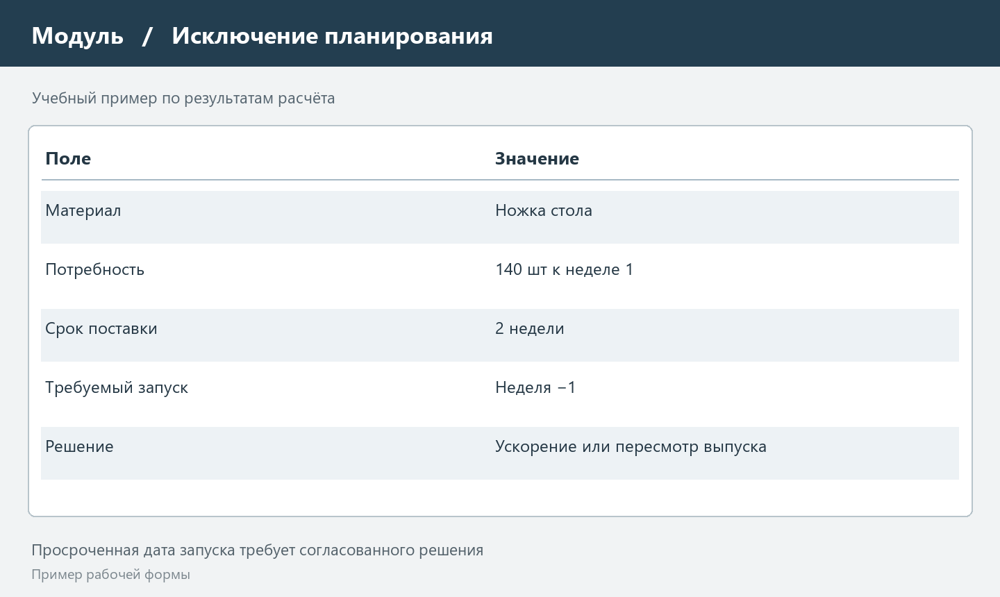
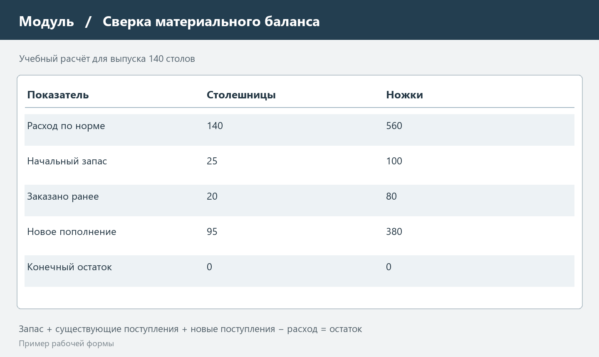

# MPS и MRP I в производственном планировании

## 1 Назначение производственного планирования

Производственный план связывает обязательства перед покупателями с выпуском продукции, закупками и состоянием запасов. Продать изделие к определённой дате можно только тогда, когда предприятие успевает получить компоненты, выполнить операции и передать готовую продукцию. Поэтому в корпоративной информационной системе необходимо согласовать не только количество изделий, но и сроки появления потребности на каждом уровне производства.

В отчёте рассматриваются MPS — главный календарный план производства — и MRP I — планирование потребности в материалах. В учебных заданиях их часто называют стандартами КИС. Здесь это обозначение используется в смысле концепций организации планирования. Они не являются взаимозаменяемыми названиями программ и не представляют собой отдельные нормативные документы ГОСТ или ISO.

MPS отвечает на вопрос, какие конечные изделия и в какие периоды предполагается выпускать. MRP I преобразует этот выпуск в потребность в деталях и материалах, учитывая состав изделия, остатки, ожидаемые поступления и сроки снабжения. Подобное разделение уровней применяется в документации производственных систем Oracle [1]. Рассчитать материалы без определённого плана выпуска невозможно: одна и та же спецификация даёт разную потребность при разных объёмах и сроках заказов.

Для самостоятельного расчётного примера выбрано условное предприятие «Модуль», выпускающее сборные столы. Приведённые объёмы, нормы и сроки являются учебными исходными данными. Они нужны для проверки логики расчёта и не описывают показатели реальной организации. На протяжении отчёта используется одна и та же номенклатура, чтобы проследить переход от спроса к заданиям на закупку.

## 2 Главный календарный план MPS

### 2.1 Спрос и план выпуска

MPS расшифровывается как Master Production Schedule. Он задаёт выпуск планируемых изделий по временным периодам. Плановая позиция должна иметь определённый код, единицу измерения и момент готовности. Запись «произвести сто столов в течение месяца» недостаточна для снабжения, если первая поставка покупателю требуется уже в начале месяца.

Источниками спроса могут быть подтверждённые заказы, прогноз продаж и внутренние потребности. Заказ и прогноз нельзя безусловно складывать: подтверждённый заказ часто уже входит в ожидаемый рыночный спрос. На предприятии заранее устанавливают правило потребления прогноза. Иначе одни и те же продажи дважды увеличат план и вызовут лишнюю закупку.

В учебном примере прогноз уже скорректирован на подтверждённые заказы. Результирующая независимая потребность по четырём неделям составляет 30, 40, 35 и 45 столов. Начальный остаток готовой продукции равен 10 столам. Это годные изделия, не зарезервированные под другие отгрузки. Незавершённое производство в эти 10 единиц не входит.

### 2.2 Горизонт и устойчивость плана

Горизонт планирования должен охватывать совокупное время получения материалов и изготовления продукции. Если поставщик привозит столешницы за две недели, а сборка занимает ещё неделю, просмотр только следующей недели не позволяет своевременно обнаружить дефицит.

Ближнюю часть плана целесообразно изменять по более строгим правилам. Заказы материалов уже размещены, оборудование подготовлено, сменные задания выданы. Перенос выпуска в этой зоне требует проверки последствий и согласования ответственных. Дальняя часть допускает более свободную корректировку по уточнённому прогнозу. Такая политика уменьшает число противоречащих друг другу поручений.

Календарные периоды должны быть едиными для связанных расчётов. Неделя поступления означает доступность материала к началу потребления по принятому календарю. Если приёмка и проверка качества занимают время, дата приезда машины ещё не равна дате доступности запаса. Эти различия следует отражать в нормативах, а не исправлять вручную после каждого пересчёта.

### 2.3 Расчёт доступного остатка

В упрощённом примере прогнозируемый остаток на конец периода равен остатку на начало плюс запланированный выпуск минус спрос. Страховой запас готовых изделий принимается равным нулю, размер партии не ограничен, частичная отгрузка разрешена. Для первой недели требуется произвести 20 столов: имеющиеся 10 и новый выпуск 20 покрывают спрос 30.

Расчёт главного плана представлен в таблице 1. Значение выпуска относится к готовности изделия в соответствующей неделе, а не к началу сборочных операций.

Таблица 1 — Учебный главный план выпуска столов

| Показатель | Неделя 1 | Неделя 2 | Неделя 3 | Неделя 4 |
| --- | --- | --- | --- | --- |
| Независимый спрос | 30 | 40 | 35 | 45 |
| Остаток на начало | 10 | 0 | 0 | 0 |
| Выпуск MPS | 20 | 40 | 35 | 45 |
| Остаток на конец | 0 | 0 | 0 | 0 |

Общий спрос составляет 150 столов, выпуск — 140, разница покрывается начальным запасом 10. Проверка итогов не заменяет проверку недель: месячная сумма может сходиться при дефиците в начале месяца и избытке в конце. Для каждой недели необходимо отдельно убедиться, что доступное количество покрывает отгрузку.

## 3 Исходные данные MRP I

### 3.1 Состав изделия

MRP I — Material Requirements Planning — рассчитывает зависимую потребность. Спрос на стол возникает независимо от состава изделия, а потребность в ножках зависит от количества запускаемых столов и нормы расхода. Учёт этой связи отличает расчёт материалов от простого пополнения склада до заданного уровня.

Спецификация BOM определяет, какие компоненты и в каком количестве входят в изделие. В рассматриваемом примере на один стол требуются одна столешница и четыре одинаковые ножки. Крепёж для упрощения не рассчитывается. Замены материалов, технологический брак и выход годного принимаются постоянными; при реальном внедрении их пришлось бы описать дополнительно.

Важно хранить действующую редакцию спецификации. Если новая конструкция использует шесть креплений вместо четырёх, расчёт по старой норме даст систематический недозаказ. Для каждого планового заказа должна быть понятна применённая редакция, дата её действия и основание изменения. Исправление справочника без учёта уже запущенных партий создаёт неоднозначность.

### 3.2 Запасы и поступления

Для расчёта недостаточно знать физическое количество на складе. Заблокированный брак, зарезервированный остаток и материал на ответственном хранении могут быть недоступны данному производственному заказу. Планировщику нужен доступный запас по согласованным правилам, а кладовщику — документы, объясняющие каждое ограничение.

Ожидаемое поступление — уже существующий заказ, который должен пополнить запас к указанной дате. Его нельзя смешивать с новым предложением MRP. Иначе система одновременно учтёт поставку и повторно предложит купить тот же объём. Подтверждение поставщика и плановая дата заказа тоже различаются: неподтверждённый срок требует отдельного контроля риска.

Входные сведения для выбранного изделия приведены в таблице 2. Сроки указаны в неделях по условному рабочему календарю. Ножки и столешницы потребляются при запуске сборки; срок сборки составляет одну неделю.

Таблица 2 — Исходные данные для расчёта компонентов

| Позиция | Норма на стол | Начальный запас | Заказанное поступление | Срок поставки |
| --- | --- | --- | --- | --- |
| Столешница | 1 шт | 25 шт | 20 шт в неделю 2 | 1 неделя |
| Ножка | 4 шт | 100 шт | 80 шт в неделю 2 | 2 недели |

### 3.3 Партии и страховой запас

Политика lot for lot предполагает пополнение ровно в размере рассчитанной чистой потребности. Она удобна для учебного объяснения, поскольку не добавляет остаток из-за округления партий. На практике минимальный объём поставки, упаковка и стоимость оформления заказа могут требовать другого количества.

Страховой запас устанавливают отдельно от планового спроса. Он предназначен для принятого уровня неопределённости, а не для сокрытия ошибок справочников. Если минимальная упаковка содержит 50 ножек, потребность 20 приводит к заказу 50 и прогнозируемому остатку 30. Эти 30 переходят в следующий период; повторно заказывать их нельзя.

## 4 Последовательность расчёта материалов

### 4.1 Валовая и чистая потребность

Валовая потребность показывает весь расход компонента, требуемый запуском изделий в периоде. Чистая потребность — часть этого расхода, которую нельзя покрыть доступным остатком и подтверждёнными поступлениями. Oracle описывает получение чистой потребности из валовой с учётом запасов и снабжения [2]. В расчётном примере используется простая недельная модель без пересекающихся календарей.

Для каждого периода выполняется одна последовательность: сначала переносится остаток предыдущего периода, затем добавляются существующие поступления, вычитается расход и проверяется минимально допустимый запас. Если результата недостаточно, формируется предложение пополнения. После округления по правилам партии рассчитывается новый конечный остаток.

При нулевом страховом запасе чистая потребность равна превышению валовой потребности над суммой начального остатка и существующих поступлений. Если превышения нет, значение принимается равным нулю. Отрицательный «заказ на закупку» не создаётся: избыток отражается остатком и отдельным сообщением о возможном переносе или отмене уже размещённой поставки.

### 4.2 Разнесение потребности во времени

Компоненты требуются к началу сборки, а не к отгрузке готового стола. Поэтому выпуск MPS сдвигается на срок сборки. Для выпуска 20 столов в неделю 1 сборка должна начаться в неделю 0; для выпуска 40 в неделю 2 — в неделю 1. Неделя 0 здесь обозначает период непосредственно перед началом показанного горизонта.

Для столешниц валовая потребность по неделям 0–3 составляет 20, 40, 35 и 45 штук. Для ножек соответствующие значения равны 80, 160, 140 и 180. В недели 4 расход под показанный выпуск уже не добавляется, потому что последний запуск произошёл в неделю 3. При появлении следующего выпуска горизонт необходимо продолжить.

### 4.3 Плановые поступления и запуски заказов

Плановое поступление должно закрыть дефицит в момент потребления. Чтобы определить дату размещения заказа, от этой даты отсчитывают срок поставки назад. Для ножек, нужных в неделю 1, новый заказ со сроком две недели требуется выпустить в неделю −1. Отрицательный номер периода — сигнал о проблеме исходного плана, а не разрешение оформить документ задним числом.

MRP формирует предложения и сообщения планировщику; они требуют проверки до превращения в реальные обязательства. Следует определить, можно ли ускорить поставку, использовать допустимую замену, перераспределить запас или согласовать другой выпуск. Отдельный список просроченных запусков позволяет увидеть невыполнимость раньше фактической остановки сборки.

## 5 Сквозной пример расчёта MRP I

Для ножек в неделю 0 имеется 100 штук, расход равен 80, остаток — 20. В неделю 1 требуется 160, но нового существующего поступления ещё нет. Чистая потребность равна 140. В неделю 2 потребность 140 частично покрывается поступлением 80, поэтому требуется ещё 60. В неделю 3 запас отсутствует и требуется 180 новых ножек.

Результаты представлены в таблице 3. Все плановые поступления рассчитаны по правилу lot for lot, поэтому после удовлетворения дефицита остаток равен нулю.

Таблица 3 — Расчёт ножек по периодам потребления

| Показатель | Неделя 0 | Неделя 1 | Неделя 2 | Неделя 3 |
| --- | --- | --- | --- | --- |
| Валовая потребность | 80 | 160 | 140 | 180 |
| Существующее поступление | 0 | 0 | 80 | 0 |
| Остаток на начало | 100 | 20 | 0 | 0 |
| Чистая потребность | 0 | 140 | 60 | 180 |
| Плановое поступление | 0 | 140 | 60 | 180 |
| Остаток на конец | 20 | 0 | 0 | 0 |

Суммарный расход ножек составляет 560: четыре на каждый из 140 выпускаемых столов. Доступные исходные ресурсы — 100 в запасе и 80 в уже размещённой поставке. Новые предложения составляют 380. Проверочное равенство: 100 + 80 + 380 − 560 = 0. Оно подтверждает материальный баланс выбранного горизонта.

Для столешниц после расхода 20 в неделю 0 остаётся 5 из начальных 25. В неделю 1 необходимо новое поступление 35, в неделю 2 — 15 с учётом существующей поставки 20, в неделю 3 — 45. Новая закупка составляет 95; баланс: 25 + 20 + 95 − 140 = 0. Срок поставки в одну неделю определяет новые размещения в недели 0, 1 и 2 соответственно.

На рисунке 1 показана учебная карточка предложения по ножкам. В ней разделены дата потребности, дата заказа и причина исключения. Это иллюстрация расчёта, а не снимок конкретной корпоративной системы.

Показанное предложение нельзя исполнить в обычном порядке, если неделя −1 уже прошла. Планировщик должен зарегистрировать решение и пересчитать зависимые задания. Если ускорение подтверждено только для 100 ножек из 140, оставшиеся 40 ограничивают сборку десяти столов. Сумма закупки сама по себе эту нехватку во времени не устраняет.

На рисунке 2 показан пример сверки баланса компонентов после расчёта. Такая форма помогает обнаружить забытый начальный остаток или дважды включённую поставку до передачи заказа снабжению.

## 6 Контроль качества и ограничения плана

Материальная обеспеченность не гарантирует наличия рабочего времени. Базовый расчёт MRP не является расписанием с конечными мощностями; документация Oracle отдельно указывает предположение о доступности неограниченной мощности в рассматриваемом расчёте [2]. Поэтому после получения материалов необходимо оценивать загрузку рабочих центров и квалифицированного персонала.

Для условного примера можно предположить, что сборка требует два нормо-часа на стол. Выпуск 45 столов потребует 90 часов, а доступная недельная мощность одного участка равна 80 часам. Все компоненты могут быть заказаны вовремя, но десять часов работы всё равно не помещаются в календарь. Решением может быть перенос части выпуска или согласованная дополнительная смена; автоматическое обещание срока без такой проверки необоснованно.

Качество исходных сведений проверяется по нескольким направлениям: актуальность спецификаций, единицы измерения, доступность остатков, даты поставок и правила партии. Ошибка «упаковка вместо штуки» способна увеличить предложение в десятки раз. Отсутствие даты действия спецификации затрудняет воспроизведение расчёта даже при сохранённом итоговом файле.

После пересчёта полезно сравнивать предложения с предыдущей редакцией. Резкое увеличение закупки требует объяснения: появился новый заказ, изменилась норма или поставщик перенёс срок. Без причины планировщик не может отличить хозяйственное событие от ошибки загрузки данных. Значимые изменения фиксируются с датой расчёта и ответственным за решение.

Факты приёмки, списания и выпуска должны своевременно поступать в расчёт. Ежедневный пересчёт по устаревшим остаткам остаётся недостоверным.

## 7 Итоги

MPS определяет выпуск конечных изделий во времени, а MRP I переводит его в зависимую потребность и предложения пополнения материалов. Их согласованная работа требует корректных спецификаций, доступных запасов, существующих поставок и реалистичных сроков. Чёткое разделение исходного заказа и нового предложения исключает повторную закупку одного и того же объёма.

Учебный расчёт показал, что для выпуска 140 столов необходимо 560 ножек. Из них 180 обеспечены запасом и существующей поставкой, новые предложения составляют 380. При этом часть заказов должна быть размещена до начала горизонта. Материальный баланс сходится, но исходный календарь нуждается в управленческом решении.

Практическая ценность расчёта состоит в раннем обнаружении отклонений и объяснимости каждого предложения. Качество плана следует оценивать одновременно по количеству, срокам и возможности исполнения. Расширение этого подхода на мощности и финансовые последствия приводит к задачам MRP II и дальнейшим уровням корпоративного планирования.

## Источники

[1] Oracle JD Edwards. Master Production Scheduling and Material Requirements Planning. https://docs.oracle.com/en/applications/jd-edwards/supply-chain-manufacturing/9.2/eoarp/master-production-scheduling-and-material-requirements-planning.html

[2] Oracle MRP User’s Guide. Material Requirements Planning. https://docs.oracle.com/cd/E26401_01/doc.122/e48795/T478564T478850.htm

[3] SAP. What is material requirements planning. https://www.sap.com/resources/what-is-material-resource-planning-mrp

Дата обращения к электронным источникам: 10 ноября 2026 года. Все числовые примеры и иллюстрации расчёта составлены для данной работы.
