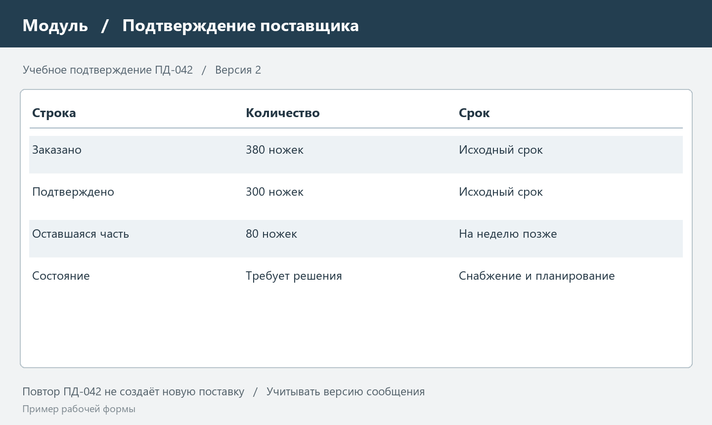

# MRP II ERP и ERP II в корпоративном управлении

## 1 Границы рассматриваемых концепций

Расчёт материалов решает только часть задачи управления предприятием. Наличие деталей не означает наличие свободного оборудования, финансов на закупку и согласованного срока поставки. По мере расширения управленческих задач появляется потребность связывать производственные планы с загрузкой ресурсов, финансовыми последствиями и действиями внешних участников.

MRP II, ERP и ERP II рассматриваются в отчёте как концепции организации корпоративного управления и информационного взаимодействия. В учебной формулировке используется слово «стандарты», однако сами эти обозначения не являются названиями нормативных документов ISO или ГОСТ. Они описывают разные границы охвата процессов, а не обязательную последовательность покупки трёх отдельных программ.

MRP II означает Manufacturing Resource Planning — планирование производственных ресурсов. ERP — Enterprise Resource Planning — расширяет интеграцию на основные процессы предприятия. ERP II связано с дальнейшим развитием взаимодействия через внешние приложения и участников. Такое историческое расширение границ описывается в материалах Oracle NetSuite [1]. Наличие веб-интерфейса само по себе ещё не доказывает соответствие организации какой-либо из этих концепций.

Для сравнения используется условный производитель сборных столов «Модуль». Все количества, тарифы, ограничения и примеры документов заданы для учебного анализа. Они не являются результатами исследования реальной компании. Пример позволяет последовательно рассмотреть одну хозяйственную ситуацию с позиций материалов, мощности, финансов и взаимодействия с поставщиком.

Главный вывод отчёта состоит в том, что увеличение числа модулей не гарантирует согласованного управления. На каждом уровне должны быть определены владельцы данных, правила изменения планов, основания документов и способы обнаружения расхождений. Без этих условий интеграция может лишь ускорить распространение ошибки между подразделениями.

## 2 Планирование производственных ресурсов MRP II

### 2.1 От материалов к выполнимому плану

MRP I рассчитывает потребность в материалах по составу изделия и срокам. MRP II рассматривает более широкий круг производственных ресурсов и связывает планы с их исполнением. В состав рассматриваемого контура входят главный план выпуска, материальное обеспечение, оценка мощности и регистрация фактических результатов. Описание MRP в SAP выделяет расширение на связанные производственные приложения при переходе к MRP II [2].

На предприятии «Модуль» запланирован выпуск 45 столов. Столешницы и ножки доступны вовремя. Если сборка требует два нормо-часа на изделие, участок должен предоставить 90 часов. При доступности только 80 часов материально обеспеченный план не помещается в рабочий календарь. Именно такой разрыв необходимо обнаруживать до выдачи окончательных обязательств.

Планировщик рассматривает несколько вариантов: часть выпуска перенести на предыдущий период, согласовать дополнительное время или привлечь другой участок. Выбор требует проверки не только мощности, но и доступности материалов в изменённую дату. При переносе десяти столов раньше расходуется сорок ножек раньше; снабжение должно подтвердить новый срок. Производственные и материальные решения связаны одним заказом, а не существуют как независимые таблицы.

### 2.2 Нормативы и доступная мощность

Потребная мощность рассчитывается по маршрутам и нормам операций. Для рабочего центра важны длительность обработки, время подготовки, размер партии и календарь доступности. Если переналадка выполняется один раз на партию, её нельзя умножать на количество изделий. Если станок одновременно обрабатывает несколько деталей, простое суммирование длительностей тоже требует уточнения.

В учебном примере подготовка включена в норму два часа на стол. Участок располагает двумя рабочими местами по 40 часов за неделю. Отпуска, ремонт и простои в исходной доступности уже учтены; повторно вычитать их нельзя. При изменении условий календарь должен пересматриваться, иначе система будет предлагать работы в заведомо недоступное время.

Проверка расчёта мощности представлена в таблице 1. Величина загрузки определяется как отношение потребных часов к доступным. Значение выше 100 процентов означает перегрузку по принятой модели.

Таблица 1 — Проверка мощности сборочного участка

| Показатель | Неделя 1 | Неделя 2 | Неделя 3 | Неделя 4 |
| --- | --- | --- | --- | --- |
| План выпуска столов | 20 | 40 | 35 | 45 |
| Норма часов на стол | 2 | 2 | 2 | 2 |
| Потребность часов | 40 | 80 | 70 | 90 |
| Доступность часов | 80 | 80 | 80 | 80 |
| Загрузка процентов | 50 | 100 | 87,5 | 112,5 |

В таблице сравниваются часы сборки партий соответствующего выпуска; при составлении календарных заданий они размещаются до момента готовности изделия. Одинаковые номера недель не отменяют срок сборки. Для точного расписания понадобятся даты операций, а не только недельные суммы.

### 2.3 Обратная связь и пересчёт

Замкнутый контур планирования предполагает возвращение фактических результатов в исходные расчёты. Приход материала подтверждает доступность запаса, завершённая операция уменьшает оставшуюся работу, брак изменяет количество годной продукции. Если сведения об исполнении не поступают, следующий пересчёт продолжает считать уже выполненную работу невыполненной.

Отклонение должно иметь причину и ответственного. Разница между планом 40 и фактом 35 столов может объясняться нехваткой материала, остановкой оборудования или неполным отражением выпуска. Эти причины требуют разных решений. Простое увеличение плана следующей недели способно перенести ошибку в будущее и создать ещё большую перегрузку.

На рисунке 1 показана учебная карточка решения по перегруженному участку. Она фиксирует исходный дефицит и согласованный вариант, чтобы последующий пересчёт можно было объяснить.

## 3 Интеграция ресурсов предприятия ERP

### 3.1 Общие данные и документы

ERP связывает основные хозяйственные процессы предприятия через согласованные сведения и документы. В определении Oracle к таким задачам относятся учёт, закупки, управление проектами, рисками и цепочками поставок [3]. Для практического анализа существенно не перечисление модулей, а возможность проследить одну операцию через разные подразделения без потери её идентичности.

Код поставщика, единица измерения и номер заказа должны иметь единое значение в снабжении, на складе и в расчётах. Если отдел закупает ножки в упаковках, а склад принимает в штуках, система обязана хранить коэффициент пересчёта и соответствующую единицу документа. Исправление числа вручную после каждой загрузки делает результат зависимым от внимательности сотрудника.

Общий информационный контур не обязательно означает одну физическую базу для всех приложений. Важно определить источник каждого вида данных, допустимые копии и правила синхронизации. Например, корпоративный справочник хранит код материала, складское приложение — расположение по ячейкам, а финансовая подсистема — проводки и обязательства. Распределение ответственности предотвращает конкурирующие изменения одной карточки.

### 3.2 Сквозной пример закупки

Снабжение оформляет заказ на 380 ножек по цене 250 рублей. Стоимость составляет 95 000 рублей без учёта налогов и доставки, которые в учебном примере исключены. Поставщик требует аванс 30 процентов: к оплате до поставки требуется 28 500 рублей. Оставшиеся 66 500 должны быть погашены по согласованному условию после приёмки.

На складе фиксируется фактическое поступление по количеству и качеству. Если вместо 380 поступило 360 годных ножек и 20 повреждённых, нельзя одновременно признать всю партию доступной сборке и полностью закрыть претензию. Для производства доступны 360; состояние оставшихся 20 определяется документом расхождения и решением по замене либо возврату.

Бухгалтерская регистрация документа отражает экономический смысл операции, но не должна подменять складскую доступность. Наличие счёта поставщика не означает физического получения материала. Наличие материала на воротах предприятия не означает завершения проверки качества. Согласованные состояния позволяют различать эти факты и сохранять основания каждого изменения.

### 3.3 Планирование финансов и контроль исполнения

В примере предприятие располагает свободным платёжным лимитом 25 000 рублей на требуемую дату. Аванс 28 500 превышает его на 3 500. Материалы и мощность могут быть обеспечены, однако заказ пока нельзя исполнить на исходных условиях. Финансовый план выявляет ещё одно ограничение, которое не видно в расчёте количества ножек.

Руководитель может согласовать перенос другого платежа, дополнительное финансирование или изменение условий поставщика. Решение должно быть отражено до подтверждения нового срока. Самовольная замена даты оплаты в учётной системе не создаёт реального согласия поставщика и может привести к остановке отгрузки.

В таблице 2 показаны контрольные факты одной закупки. Она позволяет различать плановое намерение, подтверждённое обязательство и результат исполнения.

Таблица 2 — Связанные документы закупки в ERP

| Событие | Документ или запись | Что подтверждается |
| --- | --- | --- |
| Возник дефицит | Предложение планирования | Расчётная потребность |
| Согласованы условия | Заказ поставщику | Количество цена и срок |
| Перечислен аванс | Платёж и выписка | Факт движения денег |
| Получен материал | Документ приёмки | Годное количество |
| Выявлено расхождение | Акт и претензия | Причина незакрытой части |
| Завершены расчёты | Документы погашения | Исполнение обязательств |

## 4 Взаимодействие за пределами предприятия ERP II

### 4.1 Расширение информационного контура

ERP II описывает расширение обмена за внутренние границы предприятия, включая взаимодействие с другими приложениями через интернет. В историческом обзоре NetSuite это направление связывается с подключением CRM, электронной коммерции и других систем [1]. В данном отчёте акцент сделан на организационных последствиях такого обмена: кто сообщает факт, кто вправе его изменять и как проверяется достоверность.

Поставщик может подтверждать даты через портал, покупатель — размещать заказ, а логистический оператор — передавать состояние доставки. Каждая внешняя запись влияет на внутренний процесс, но не должна автоматически получать права внутреннего сотрудника. Например, поставщик сообщает ожидаемую дату отправки, а предприятие сохраняет собственную оценку даты готовности материала после приёмки.

ERP II нельзя сводить к смене способа установки ERP. Облачное размещение определяет техническую модель доступа и эксплуатации; внешний согласованный обмен определяет границы процессов. Веб-страница с изолированным списком документов ещё не обеспечивает сквозное взаимодействие, даже если открывается через интернет.

### 4.2 Подтверждение поставки и исключения

Для заказа на 380 ножек поставщик подтверждает 300 в исходную дату и 80 на неделю позже. Если передать только общий статус «подтверждён», планирование не заметит частичную задержку. Требуется раздельное сообщение по количеству и сроку либо отдельные строки графика поставки. После подтверждения система сравнивает новые сведения с датами потребления в производстве.

Внутреннее решение может включать перенос сборки, закупку недостающего объёма у второго поставщика или согласование ускорения. До выбора варианта сообщение остаётся исключением, требующим действия. Закрывать его только потому, что обмен завершился без технической ошибки, нельзя: успешная доставка сообщения не равна хозяйственной выполнимости обещания.

На рисунке 2 показан пример формы внешнего подтверждения. Отдельно обозначены подтверждённые количества и версия сообщения. Эти сведения позволяют проверить последствия частичной поставки и не принять повторный пакет за новый заказ.

### 4.3 Надёжность и безопасность обмена

Интеграция должна учитывать повторную доставку, нарушение порядка и временную недоступность другой стороны. В учебном случае каждому подтверждению назначается уникальный номер, а строке поставки — версия. Повторное сообщение с тем же номером не увеличивает количество. Более старая версия не заменяет уже принятый новый срок без отдельного решения.

Права доступа задаются по назначению участника. Поставщик видит свои заказы и подтверждает свои поставки, но не получает список закупок у конкурентов. Покупатель видит собственные обязательства и не должен менять учётные документы предприятия. Проверка принадлежности выполняется сервером для каждого запроса, а не только скрытием кнопок интерфейса.

Для внешнего обмена необходимы защищённый транспорт, управление ключами доступа, журнал значимых изменений и процедура отзыва прав. Ошибки не должны раскрывать содержимое чужих документов. Эти требования рассматриваются как условия выбранного учебного взаимодействия; наличие термина ERP II в описании продукта не подтверждает их фактическое выполнение.

## 5 Сравнение и совместное применение

MRP II, ERP и ERP II можно сравнивать по управленческому охвату, но не по признаку «старый или новый интерфейс». Одна корпоративная платформа может одновременно рассчитывать материалы, проверять мощность, вести финансовый учёт и обмениваться подтверждениями. Для оценки полезно установить, какое решение требуется пользователю и какие данные для него действительно согласованы.

Сравнение приведено в таблице 3. Разделение условно отражает акценты концепций, а не запрещает функциям пересекаться в конкретной реализации.

Таблица 3 — Сравнение управленческих акцентов

| Критерий | MRP II | ERP | ERP II |
| --- | --- | --- | --- |
| Основной охват | Производственные ресурсы | Процессы предприятия | Межорганизационный обмен |
| Пример решения | Устранить перегрузку сборки | Согласовать закупку и оплату | Уточнить график поставщика |
| Ключевой риск | Нереальные нормы мощности | Несогласованные справочники | Чужие и повторные сообщения |
| Требуемая связь | План и факт производства | Документы подразделений | Внутренние и внешние события |

Для предприятия «Модуль» последовательность проверки выглядит следующим образом. Сначала рассчитывается потребность в компонентах, затем проверяется доступность рабочих часов. После этого согласуются деньги и договорные условия, а внешние подтверждения уточняют даты. Изменение любого существенного условия может потребовать возврата на предыдущие уровни расчёта.

Такой подход позволяет избежать локальной оптимизации. Закупка дешёвой крупной партии уменьшает цену единицы, но увеличивает потребность в деньгах и складской площади. Перенос выпуска ради равномерной загрузки может потребовать более ранних компонентов. Ускорение поставки может повысить затраты на перевозку. Общая оценка должна учитывать связанные последствия, а не только показатель одного подразделения.

## 6 Организация внедрения и проверка результатов

Начинать внедрение целесообразно с границ процессов и состояния исходных данных. Следует выбрать изделия, подразделения и набор документов пилотного контура. Если одновременно менять справочники, маршруты, расчёт зарплаты и все внешние обмены, причину расхождения будет трудно установить. Ограниченный пилот облегчает проверку сквозного результата на понятном наборе операций.

В учебном плане внедрения сначала сверяются остатки ножек и столешниц, нормы на стол и рабочий календарь. Затем выполняется контрольный расчёт потребности и мощности. После подтверждения арифметики проверяется финансовая часть заказа и приёмка с расхождением. Внешнее подтверждение подключается после того, как внутренние состояния уже имеют определённый смысл.

Для приёмки недостаточно показать, что открываются экраны. Нужно пройти сценарий с ожидаемыми изменениями: заказ 380 ножек, аванс 28 500 рублей, частичная поставка и корректировка обеспеченности сборки. Проверяются суммы, количества, даты, права доступа и сохранение связи документов. Повторная загрузка внешнего сообщения не должна создавать вторую поставку.

Показатели результата выбираются до начала эксплуатации. Для рассматриваемого предприятия полезны доля заказов с подтверждённым сроком, число остановок по материалам, частота перегрузки участка и размер просроченных обязательств. Улучшение нельзя приписывать программе без сопоставимого периода наблюдения: сезонный спад заказов тоже способен временно уменьшить задержки.

Сопровождение включает пересмотр нормативов и контроль изменений справочников. Если фактическая сборка постоянно занимает больше двух часов, требуется выяснить причину: неверная норма, иной состав работ или потери времени. Механическое увеличение нормы без анализа закрепляет отклонение, а сохранение заведомо неправильной нормы делает план недостоверным.

Ответственность должна быть закреплена за хозяйственными решениями. Администратор поддерживает систему, но не выбирает за снабжение срок закупки и не утверждает за финансовую службу аванс. Владелец процесса определяет допустимые состояния и исключения; техническая реализация обеспечивает их воспроизводимую регистрацию и контроль.

## 7 Итоги

MRP II расширяет рассмотрение производства за пределы материальной потребности и требует согласования ресурсов и исполнения. ERP связывает хозяйственные процессы подразделений, а ERP II акцентирует внешнее взаимодействие и обмен с другими участниками. В конкретной системе эти функции могут сосуществовать и использовать общие сведения.

Сквозной пример выявил три разных ограничения одного выпуска: нехватку десяти часов сборки, превышение платёжного лимита на 3 500 рублей и частичную задержку поставщика. Каждое ограничение требует своего решения и может повлиять на остальные планы. Сводный статус заказа без количеств, сроков и оснований скрывает эти различия.

Результат корпоративной интеграции следует оценивать по согласованности решений и возможности проследить их исполнение. Полезная система показывает источник цифры, ответственного за изменение и хозяйственные последствия нового факта. Увеличение охвата оправдано тогда, когда оно помогает принимать выполнимые обязательства и своевременно обрабатывать отклонения.

## Источники

[1] Oracle NetSuite. The History of ERP. https://www.netsuite.com/portal/resource/articles/erp/erp-history.shtml

[2] SAP. What is material requirements planning. https://www.sap.com/resources/what-is-material-resource-planning-mrp

[3] Oracle. What is ERP. https://www.oracle.com/erp/what-is-erp/

[4] Oracle MRP User’s Guide. Material Requirements Planning. https://docs.oracle.com/cd/E26401_01/doc.122/e48795/T478564T478850.htm

Дата обращения к электронным источникам: 10 ноября 2026 года. Числовые примеры и иллюстрации составлены для данной работы.
