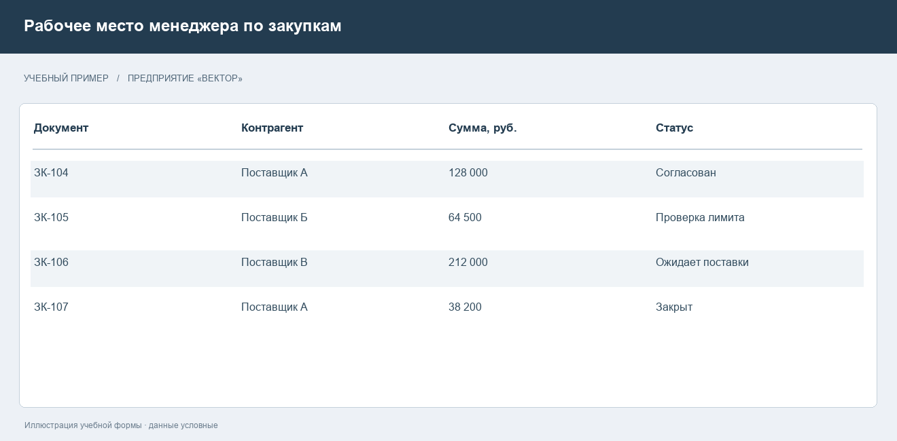
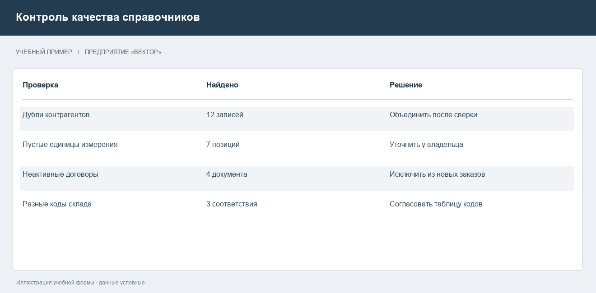

# Корпоративные информационные системы и требования к их построению

## Понятие и назначение корпоративной системы

Корпоративная информационная система объединяет программные средства, данные, инфраструктуру и правила работы, которые обеспечивают деятельность организации. Её корпоративный характер определяется охватом связанных процессов и согласованностью информации. Большое число пользователей само по себе не делает систему корпоративной: отдельный массово используемый сервис может обслуживать только одну узкую задачу.

На предприятии один хозяйственный факт затрагивает несколько подразделений. Заказ покупателя влияет на планирование, резервирование материалов, отгрузку, расчёты и управленческую отчётность. Если каждый участник ведёт независимую копию данных, возникают расхождения: товар уже отгружен, но числится доступным; оплата поступила, но заказ остаётся заблокированным. КИС должна поддерживать согласованное выполнение таких операций и понятное распределение ответственности.

ERP является одним из центральных классов корпоративных решений и охватывает планирование и учёт ресурсов. При этом КИС может включать ERP вместе с другими специализированными системами. В описании SAP ERP связывается с основными процессами организации, включая финансовую деятельность, закупки и цепочки поставок [1].

В данном отчёте рассматриваются состав КИС, требования к функциям и качеству, интеграция, эксплуатация и применимые стандарты. Самостоятельный учебный пример относится к производственно-торговому предприятию «Вектор». Все его документы, значения и ситуации условны. Они используются для разбора требований, а не для утверждений о результатах конкретного внедрения.

Основная задача при построении КИС — обеспечить достоверность операций и управляемость изменений. Выбор платформы важен, однако программный продукт не решает автоматически вопросы качества данных, ответственности, обучения и организации поддержки.

## Состав и классы корпоративных решений

Состав КИС зависит от деятельности предприятия. Производственной организации нужны сведения о материалах, заказах и выпуске продукции. Сервисной компании важнее управление обращениями, договорами и загрузкой специалистов. У торговой сети большую роль играют ассортимент, цены, поставки и складские остатки. Поэтому перечень модулей формируют по процессам, а не по количеству функций в рекламном описании продукта.

ERP обеспечивает общую основу планирования и учёта. CRM поддерживает работу с клиентами. SCM относится к управлению цепочками поставок. WMS детализирует складские операции. MES используется для управления производственными операциями. Системы электронного документооборота обеспечивают движение и хранение документов, а аналитические средства помогают сопоставлять результаты и выявлять отклонения.

В таблице 1 приведено примерное распределение задач. Оно не является обязательной схемой: границы возможностей продуктов могут пересекаться.

Таблица 1 — Назначение компонентов КИС

| Компонент | Основная задача | Пример информации |
| --- | --- | --- |
| ERP | Планирование ресурсов и учёт операций | Заказы, затраты, обязательства |
| CRM | Управление отношениями с клиентами | Обращения, сделки, контакты |
| WMS | Детальное управление складом | Ячейки, задания на размещение |
| MES | Управление производственными операциями | Задания, выпуск, простои |
| Документооборот | Согласование и хранение документов | Договоры, маршруты согласования |
| Аналитика | Сопоставление и анализ показателей | Выручка, запасы, выполнение плана |

Наличие нескольких систем требует определения владельца каждого вида данных. Например, справочник товаров может изменяться в ERP, а складская система получает утверждённые позиции. Если изменения разрешены везде без согласования, обмен будет распространять противоречия вместо их устранения.

## Сквозной процесс и распределение ответственности

Рассмотрим закупку материалов. Подразделение регистрирует потребность, снабжение уточняет условия, руководитель согласовывает расходы, склад принимает поставку, бухгалтерия отражает документы и оплату. Каждое действие изменяет состояние общего хозяйственного процесса. КИС должна позволять проследить путь документа и объяснить, почему он находится на определённом этапе.

Роль сотрудника определяет доступные операции. Заявитель создаёт потребность, но не должен сам подтверждать её оплату. Кладовщик фиксирует приёмку в пределах своих полномочий. Бухгалтер работает с расчётными документами. Разделение обязанностей уменьшает вероятность случайной ошибки и упрощает последующую проверку.

В учебном примере менеджер видит список заказов с состояниями и суммами. Такой экран показан на рисунке 1. Он иллюстрирует связь документов, а не интерфейс какого-либо реального программного продукта.

Важны правила изменения состояния. Отмена заказа после частичной поставки требует другой обработки, чем отмена черновика. Изменение цены после согласования должно оставлять след и при необходимости запускать повторное согласование. Простое редактирование строки без сохранения основания изменения приводит к потере управленческой информации.

Для каждого документа необходимо определить уникальный идентификатор, автора, дату создания, допустимые состояния и условия перехода. Печатный номер полезен для сотрудников, но не всегда достаточен как технический ключ: в разных филиалах или периодах номера могут совпадать. Система должна предотвращать смешение таких документов.

## Функциональные требования и критерии приёмки

Функциональные требования описывают действия системы. Формулировка «автоматизировать закупки» не позволяет проверить результат. Необходимо указать, кто создаёт заявку, какие поля обязательны, как выбирается согласующий, что происходит при превышении лимита и какие сведения попадают в журнал действий.

Пример проверяемого требования: система не позволяет отправить заявку на согласование, если отсутствуют номенклатура, количество или подразделение. При ошибке пользователь получает сообщение с указанием поля. Другой пример: повторная отправка одного и того же подтверждения поставки не создаёт второй приходный документ. Такие требования можно превратить в приёмочные сценарии.

Критерии приёмки согласуют до разработки. Для положительного сценария задают исходные данные, последовательность действий и ожидаемый результат. Для отрицательного — причину отказа и состояние, которое должно сохраниться. Важно проверять не только сообщение об ошибке, но и отсутствие побочного изменения данных.

У учебного предприятия можно установить следующие правила: заявка с допустимыми значениями попадает в очередь руководителя; отклонённая заявка содержит причину; принятый товар увеличивает остаток только один раз; отменённый заказ не допускает новой отгрузки без восстановления установленным способом. Это проектные правила примера, а не универсальные требования любого предприятия.

Требования следует связывать с потребностью бизнеса. Если поле включено в форму, должно быть понятно, кто использует его значение. Обязательные поля без дальнейшего применения увеличивают время ввода и стимулируют сотрудников указывать формальные значения. Полезнее уменьшить лишний ввод и обеспечить достоверность действительно нужных сведений.

## Требования к качеству и надёжности

Качество КИС включает способность выполнять нужные функции при заданных условиях эксплуатации. Для обсуждения качественных характеристик можно использовать модель ISO/IEC 25010:2023, предназначенную для спецификации и оценки качества продуктов информационных технологий [3]. Однако ссылка на стандарт не заменяет конкретных измеримых требований.

Показатели производительности задают вместе с нагрузкой. Утверждение «система отвечает быстро» непроверяемо. В учебном техническом задании можно установить: при 100 одновременно работающих сотрудниках 95 процентов запросов списка заказов должны завершаться за 2 секунды на согласованном объёме данных. Эти значения выбраны для примера; реальное предприятие определяет их после изучения нагрузки.

Надёжность включает корректность восстановления после ошибок. Если связь прервалась во время проведения документа, пользователь должен получить определённый результат: операция выполнена, отклонена либо требует проверки состояния. Неопределённый ответ без возможности сверки провоцирует повторный ввод и дублирование операций.

В таблице 2 показаны примеры измеримых требований. Они не являются результатами испытаний.

Таблица 2 — Примеры требований к качеству КИС

| Область | Пример условия | Проверка |
| --- | --- | --- |
| Производительность | 95 процентов запросов до 2 с при заданной нагрузке | Нагрузочный тест |
| Восстановление | Потеря не более 15 минут данных | Восстановление резервной копии |
| Доступность | Регламент работы и допустимый простой согласованы | Учёт инцидентов |
| Удобство | Ошибка указывает поле и способ исправления | Приёмочный сценарий |
| Сопровождение | Изменение имеет версию и способ отката | Проверка выпуска |

Предельная потеря данных и допустимое время восстановления — разные показатели. Первая определяет, насколько далеко назад можно вернуться по данным, второй — сколько времени разрешено потратить на восстановление работы. Оба показателя влияют на архитектуру и стоимость эксплуатации.

## Интеграция и согласованность данных

Интеграция связывает приложения, которые решают разные задачи. Для обмена могут применяться API, сообщения, события и пакетная передача файлов. IBM описывает корпоративную интеграцию как сочетание нескольких подходов, позволяющих связывать услуги и приложения в неоднородной информационной среде [2].

Выбор способа зависит от смысла операции. Для немедленной проверки лимита может потребоваться синхронный запрос. Уведомление аналитической системы о проведённом документе можно передать асинхронно. Большой ночной обмен архивными данными не обязательно организовывать так же, как подтверждение складской операции.

Для обмена необходимо определить формат, идентификаторы, обязательные поля, правила версий и обработку повторов. Если сообщение о приёмке доставлено дважды, система должна распознать повтор по устойчивому ключу. Сравнение только суммы и даты ненадёжно: две разные поставки могут иметь одинаковые значения.

Справочники требуют отдельного управления. Номенклатура, контрагенты, единицы измерения и подразделения используются многими процессами. Ошибка в одном коде способна исказить остатки и отчётность. Перед переносом данных выполняют поиск дублей, сверку обязательных полей и согласование владельцев записей. На рисунке 2 показан учебный журнал такой проверки.

При сбое обмена нужны журнал, повторная обработка и способ ручного разбора. Сотрудник должен видеть, что документ ожидает передачи, а специалист поддержки — техническую причину и идентификатор операции. Секреты доступа при этом не должны попадать в пользовательские сообщения и журналы общего доступа.

## Информационная безопасность и эксплуатация

Безопасность КИС охватывает технические и организационные меры. Одной авторизации недостаточно. Следует определить доступ к данным, правила изменения полномочий, регистрацию действий, восстановление и порядок реагирования на инциденты. ISO/IEC 27001:2022 устанавливает требования к системе менеджмента информационной безопасности и управлению рисками [4]. Это стандарт управления, а не сертификат безошибочности отдельной программы.

Для учебного предприятия доступ можно выдавать по ролям и подразделениям. Менеджер видит свои договоры, руководитель — согласуемые расходы, администратор управляет учётными записями. Права администратора не должны автоматически превращаться в право незаметного изменения хозяйственных документов. Привилегированные действия требуют отдельного контроля.

Журнал аудита полезен, когда позволяет установить исполнителя, время, объект и содержание изменения. Избыточная запись всех данных создаёт новые риски: в журнал могут попасть пароли, личные сведения и содержимое документов. Поэтому состав журнала определяют заранее, а доступ к нему ограничивают.

Резервное копирование проверяют восстановлением. Успешное завершение задания копирования не гарантирует, что данные можно прочитать и согласованно вернуть в работу. Для проверки используют изолированную среду, сверяют целостность документов и измеряют фактическое время восстановления.

Эксплуатация требует мониторинга доступности, ошибок, очередей обмена, свободного места и длительности операций. Для каждого сигнала нужен ответственный и понятный порядок действий. Уведомление без установленного получателя не устраняет проблему. План обслуживания также должен учитывать обновления, истечение сертификатов, рост данных и проверку прав бывших сотрудников.

## Стандарты и границы их применения

Для КИС не существует одного документа, который полностью определяет все функции и архитектуру. Используется сочетание стандартов качества, безопасности, интеграции и внутренних правил. Выбор зависит от отрасли, договорных обязательств и состава системы. Важно различать общую практику, обязательное требование договора и требование законодательства.

Исторически MRP относится к планированию потребности в материалах, MRP II расширяет рассмотрение до производственных ресурсов, ERP охватывает ресурсы предприятия шире. Эти понятия полезны для описания развития подходов, но их нельзя выдавать за единый сертификат соответствия продукта. Надпись «ERP» не подтверждает автоматически полноту функций конкретного внедрения.

Назначение нескольких применимых документов сопоставлено в таблице 3.

Таблица 3 — Стандарты и области применения

| Документ | Область | Практическое применение |
| --- | --- | --- |
| ISO/IEC 25010:2023 | Модель качества продукта | Основа для выбора характеристик и критериев оценки |
| ISO/IEC 27001:2022 | Менеджмент информационной безопасности | Управление рисками и организацией защиты |
| ISA-95 / IEC 62264 | Интеграция управления предприятием и производством | Согласование уровней и обмена производственной информацией |
| Внутренние регламенты | Правила конкретного предприятия | Полномочия, справочники, согласование, эксплуатация |

ISA-95 рассматривает взаимодействие корпоративного и производственного уровней [5]. Для производственного предприятия это помогает согласовать смысл передаваемой информации. Для компании без производственного контура применимость соответствующих моделей нужно обосновывать, а не включать их в требования формально.

При ссылке на стандарт фиксируют номер, редакцию, применимую часть и ожидаемое подтверждение. Формулировка «соответствует всем международным стандартам» не проверяется и не должна использоваться в техническом задании. Открытые описания стандартов позволяют установить назначение, но не заменяют изучение нормативного текста при формальной оценке соответствия.

## Внедрение и проверка результата

Внедрение начинается с обследования деятельности и установления границ. Затем выбирают приоритетные процессы, согласуют требования, подготавливают данные и выполняют настройку или разработку. Пилотный запуск позволяет проверить решения на ограниченном контуре до распространения на всю организацию.

Перенос данных требует отдельного плана. Необходимо определить источники, правила очистки, соответствия кодов, контрольные суммы и ответственных за сверку. Сопоставление итоговых остатков и открытых обязательств важнее самого факта успешного импорта файла. При обнаружении расхождения должна существовать процедура исправления и повторной проверки.

Обучение сотрудников привязывают к рабочим сценариям. Менеджеру закупок нужно уметь создать заявку, исправить отклонение и найти причину задержки. Общий обзор меню не подтверждает готовность выполнять эти операции. Полезно проводить приёмку с участием будущих пользователей на данных, близких к реальным по структуре.

Переход в эксплуатацию предполагает план запуска, резервное копирование, критерии остановки и порядок возврата. Если после переключения обнаружится несогласованность остатков, решение об откате должно приниматься по заранее установленным условиям. Импровизация в этот момент увеличивает риск потери операций, выполненных уже в новой системе.

Результат внедрения оценивают по согласованным показателям: полноте данных, длительности обработки, количеству возвратов и доступности информации. Экономический эффект нельзя выводить только из числа установленных модулей. Для обоснованной оценки нужны исходные значения, период наблюдения и учёт изменений нагрузки.

КИС становится рабочим инструментом предприятия, когда поддерживает сквозные процессы, обеспечивает проверяемость операций и допускает управляемое развитие. Техническая платформа, качество данных, ответственность пользователей и эксплуатационная дисциплина должны рассматриваться совместно.

## Источники

[1] SAP. Enterprise resource planning software. https://www.sap.com/products/erp.html

[2] IBM. Enterprise Integration. https://www.ibm.com/think/topics/enterprise-integration

[3] ISO. ISO/IEC 25010:2023. https://www.iso.org/standard/78176.html

[4] ISO. ISO/IEC 27001:2022. https://www.iso.org/standard/27001

[5] ISA. ISA-95 Series of Standards. https://www.isa.org/standards-and-publications/isa-standards/isa-95-standard

Дата обращения — 8 ноября 2026 года. Иллюстрации рабочих форм и примеры требований подготовлены для учебного разбора. Числовые показатели являются примерами проектных условий, а не результатами измерений.
